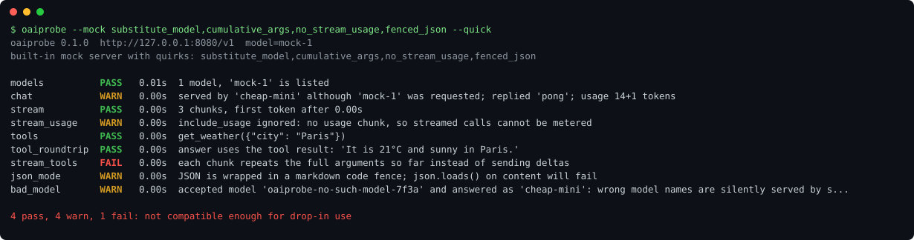

# oaiprobe

[](https://github.com/Yi-111-a/oaiprobe/actions/workflows/ci.yml)
[](LICENSE)


**"OpenAI-compatible" is a spectrum. Find out where your endpoint sits before your agent does.**

DeepSeek, vLLM, Ollama, llama.cpp, LM Studio, LiteLLM, OpenRouter, one-api/new-api gateways and resellers all say they speak the OpenAI Chat Completions API. In practice the gaps show up at the worst moment: streamed tool-call arguments that never assemble into valid JSON, `stream_options` rejected with a 400, `max_completion_tokens` unknown, JSON mode wrapped in a markdown fence, no token usage when streaming, or a gateway that quietly answers with a cheaper model than the one you asked for.

`oaiprobe` sends about 20 tiny requests to any OpenAI-compatible base URL and tells you, check by check, what works, what is quirky and what is broken.



- **Zero dependencies**: one `pip install`, pure Python 3.9+ standard library.
- **20 checks** covering what agent frameworks actually rely on: streaming, `stream_options.include_usage`, `max_tokens` and `max_completion_tokens`, `stop`, forced and `required` tool choice, sending tool results back, streamed tool-call deltas, parallel tool calls, `json_object`, strict `json_schema`, `logprobs`, `n`, the `developer` role, error shapes, auth, and non-standard fields such as `reasoning_content` and cache-hit counters.
- **Catches silent model substitution**: flags responses served by a different model than requested, and endpoints that happily answer for a model name that does not exist.
- **Cheap**: every prompt is a few words and every answer is capped or tiny. `--quick` runs the 9 core checks.
- **CI friendly**: `-f json` or `-f markdown` (paste it into a PR or `$GITHUB_STEP_SUMMARY`), exit code 1 on failures (or on warnings with `--strict`).
- **Built-in mock server** with 23 switchable quirks, so you can see what each failure looks like or test your own client against a misbehaving server.

## Install

```bash
pipx install git+https://github.com/Yi-111-a/oaiprobe
# or: pip install git+https://github.com/Yi-111-a/oaiprobe
```

Or run it from a clone with `python -m oaiprobe`.

## Usage

```bash
export OPENAI_API_KEY=sk-...                                  # or OAIPROBE_API_KEY, or -k
oaiprobe -u https://api.deepseek.com -m deepseek-chat
oaiprobe -u http://localhost:11434/v1 -m qwen2.5:7b           # Ollama
oaiprobe -u http://localhost:8000/v1                          # vLLM: model picked from GET /models
oaiprobe -u https://openrouter.ai/api/v1 -m qwen/qwen3-32b -p temperature=0
oaiprobe -u https://my-gateway.example/v1 -H "X-Tenant: team-a" --quick -f markdown

oaiprobe --mock                                               # no endpoint needed
oaiprobe --mock substitute_model,cumulative_args              # what broken gateways look like
oaiprobe --serve-mock 127.0.0.1:8080 --quirks no_done,args_object   # a bad server for your own tests
```

| Option | Meaning |
|---|---|
| `-u, --base-url` | Base URL including `/v1` where the provider needs it (default `$OPENAI_BASE_URL`) |
| `-k, --api-key` | API key, sent as `Authorization: Bearer`. Never printed. Use `-H "api-key: ..."` for Azure-style keys |
| `-m, --model` | Model to test (default: first model listed by `GET /models`) |
| `-p, --param key=value` | Extra field sent with every chat request, JSON-parsed if possible (`temperature=0`, `reasoning_effort=low`, `enable_thinking=false`) |
| `--quick`, `--only`, `--skip` | Choose checks (`--list-checks` shows them) |
| `-f text\|json\|markdown` | Output format |
| `--strict` | Exit 1 on warnings as well as failures |
| `--timeout` | Per-request timeout in seconds (default 60) |

Exit codes: `0` no failures, `1` at least one `FAIL` (or `WARN` with `--strict`), `2` usage error or endpoint unreachable.

## Real example: llama.cpp

CI's live job starts llama.cpp's `llama-server` with Qwen2.5-0.5B-Instruct on a CPU runner and probes it on every push. A local run of the same setup ([full report](examples/llama.cpp-qwen2.5-0.5b.md)):

```text
$ oaiprobe -u http://127.0.0.1:8080/v1 -k $KEY -m qwen2.5-0.5b
models                 PASS   0.00s  1 model, 'qwen2.5-0.5b' is listed
chat                   PASS   0.22s  replied 'pong', usage 26+4 tokens
stream                 PASS   0.18s  3 chunks, first token after 0.16s
stream_usage           PASS   0.05s  usage 36+2 tokens in final chunk
...
stream_tools           PASS   0.68s  7 argument fragments -> get_weather({"city": "Paris"})
parallel_tools         PASS   2.17s  2 tool calls with distinct ids
json_schema            PASS   1.51s  matches the schema: {"name": "Paris", "country": "France", ...
bad_model              WARN   0.10s  accepted model 'oaiprobe-no-such-model-7f3a' and answered as 'qwen2.5-0.5b': ...
auth                   PASS   0.00s  HTTP 401 without a key
extras                 INFO       -  usage.prompt_tokens_details.cached_tokens, system_fingerprint, timings

18 pass, 1 warn, 0 fail: compatible, with caveats
```

The one warning is expected for a single-model server; on a gateway or reseller the same warning means you cannot trust the model name you pay for.

## The checks

| Check | What it verifies | Typical breakage |
|---|---|---|
| `models` | `GET /models` returns `{"data": [...]}` and lists your model | 404, missing `/v1` |
| `chat` | Response shape, `finish_reason`, `usage` adds up, the `model` field matches | wrong model served, no usage |
| `stream` | SSE framing, `chat.completion.chunk` objects, `finish_reason`, `[DONE]`, time to first token | missing `[DONE]`, non-JSON data lines |
| `stream_usage` | `stream_options: {"include_usage": true}` yields a usage chunk | 400 on `stream_options`, usage silently dropped |
| `max_tokens` / `max_completion_tokens` | Limits are honoured with `finish_reason: "length"` | ignored limit, newer parameter rejected |
| `stop` | Stop sequences cut the output | ignored |
| `tools` | Forced function call returns `tool_calls` with a string `arguments` holding valid JSON | arguments as an object, tool call printed as text |
| `tool_choice_required` | `tool_choice: "required"` | 400 |
| `tool_roundtrip` | Assistant `tool_calls` + `role: "tool"` result is accepted and used | 400 on tool messages |
| `stream_tools` | Streamed argument deltas (with `index` and `id`) concatenate to valid JSON | cumulative instead of incremental arguments |
| `parallel_tools` | Several tool calls with distinct ids in one turn | duplicate ids |
| `json_mode` | `response_format: json_object` content parses with `json.loads` | markdown fences, `<think>` blocks |
| `json_schema` | Strict structured output matches the schema | accepted but not enforced |
| `logprobs`, `n` | Token logprobs with alternatives; several choices | silently ignored |
| `developer_role` | `role: "developer"` messages (sent by OpenAI SDKs for reasoning models) | 400 |
| `bad_model` | Unknown model names get an OpenAI-shaped 4xx error | silent fallback model, HTML error pages |
| `auth` | Requests without a key are rejected | open endpoint |
| `extras` | Lists non-standard fields (`reasoning_content`, `prompt_cache_hit_tokens`, `timings`, ...) | informational |

Results are `PASS`, `WARN` (works differently from OpenAI, or a feature is missing), `FAIL` (something a standard client will trip over), `SKIP` and `INFO`. Model-dependent behaviour, such as a small model not following an instruction, is reported as `INFO` or `WARN`, never as an endpoint failure.

## Mock server and quirks

`oaiprobe --list-quirks` prints all 23. Some highlights: `no_done`, `reject_stream_options`, `no_stream_usage`, `ignore_max_tokens`, `reject_max_completion_tokens`, `args_object`, `cumulative_args`, `single_tool_call`, `substitute_model`, `fenced_json`, `ignore_schema`, `reasoning` (DeepSeek-style `reasoning_content` and cache counters), `html_errors`.

Use it from Python tests too:

```python
from oaiprobe.mock import MockServer

with MockServer(quirks=["cumulative_args"]) as base_url:   # http://127.0.0.1:<port>/v1, key "sk-oaiprobe-mock", model "mock-1"
    run_my_client_against(base_url)
```

## Privacy and cost

`oaiprobe` talks only to the URL you give it. It never prints your key or the values of headers you pass. A full run is roughly 20 requests with prompts of a few words; most answers are a single word or capped at 8 tokens.

## 中文说明

`oaiprobe` 用来检测一个号称“兼容 OpenAI”的大模型接口到底兼容到什么程度。DeepSeek、vLLM、Ollama、llama.cpp、各种 one-api/new-api 中转站都说兼容，但流式工具调用参数拼不成合法 JSON、`stream_options` 直接报 400、JSON 模式套了 markdown 代码块、流式不返回 token 用量，甚至偷偷换成便宜模型回答，这些问题往往要等到 Agent 跑挂了才发现。

它会向指定的 base URL 发送约 20 个极小的请求，逐项给出 PASS / WARN / FAIL：流式输出、用量统计、`max_tokens` 与 `max_completion_tokens`、停止词、强制与 `required` 工具调用、工具结果回传、流式工具参数增量、并行工具调用、JSON 模式、严格 `json_schema`、logprobs、`n`、`developer` 角色、错误格式、鉴权，以及 `reasoning_content`、缓存命中等非标准字段。对中转站尤其有用的一项是检测“请求不存在的模型名也照样回答”和“返回的 model 与请求不一致”，可以发现偷换模型。

```bash
pipx install git+https://github.com/Yi-111-a/oaiprobe
oaiprobe -u https://api.deepseek.com -k sk-... -m deepseek-chat
oaiprobe --mock substitute_model,cumulative_args   # 不需要任何接口，先看看问题长什么样
```

零依赖、支持 JSON/Markdown 输出和 CI 退出码，内置可模拟 23 种常见兼容问题的 mock 服务器。API Key 不会被打印。

## License

MIT
